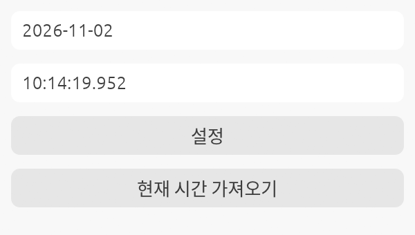

# 마우스 클릭 매크로

이 프로그램은 사용자가 지정한 시간에 자동으로 마우스 좌클릭을 수행합니다.

> [!CAUTION]
> 실전에서 사용하기 전에 꼭 자신의 컴퓨터에서 클릭이 작동하는지 확인하고 그다음 사용해 주세요.
> enigo 라이브러리 이슈로 리눅스 Wayland 환경에서는 작동 안할 수도 있습니다.

## 다운로드

Windows용 실행 파일은 [Releases](https://github.com/lidarbtc/cursor-macro/releases)에서 받을 수 있습니다. `weverse-macro.exe` 파일 하나로 실행되며 GTK 같은 런타임을 따로 설치할 필요가 없습니다.

## 빌드 환경 구축 방법

[rustup](https://rustup.rs)으로 Rust를 설치한 뒤, 운영 체제별로 아래 도구를 준비합니다.

### Linux

```bash
sudo apt install build-essential pkg-config libxkbcommon-dev
```

### macOS

```bash
xcode-select --install
```

### Windows

rustup 설치 중에 안내되는 Visual Studio C++ 빌드 도구만 있으면 됩니다.

## 프로그램 빌드 방법

아래의 명령어를 사용하여 프로그램을 빌드합니다. 이 과정을 통해 `target/release` 폴더에 실행 파일이 생성됩니다.

```bash
cargo build --release
```

Windows에서는 C 런타임까지 정적으로 링크하므로 `weverse-macro.exe` 파일 하나만 옮겨도 다른 PC에서 실행됩니다.

## 사용 방법



1. 실행 파일을 다운로드하거나, 위의 지시사항에 따라 직접 빌드합니다.
2. 실행 파일을 사용하여 원하는 시간에 자동 클릭을 설정합니다.
